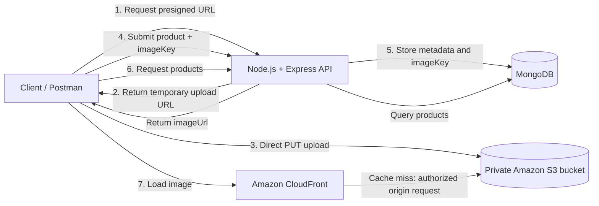

# CloudCart Product API

> A production-minded Node.js API for managing products and their images with MongoDB, Amazon S3, and CloudFront.

CloudCart separates structured product data from image storage:

- **MongoDB** stores product metadata and the S3 object key.
- **Amazon S3** stores the original image in a private bucket.
- **Presigned S3 URLs** let clients upload images directly to S3 without routing file bytes through the API.
- **Amazon CloudFront** delivers images through a CDN while Origin Access Control (OAC) protects the S3 origin.

The API is designed to be used by a frontend, Postman, or any HTTP client.

## Features

- Create, read, update, and delete products
- Direct image uploads to S3 using five-minute presigned `PUT` URLs
- JPEG, PNG, and WebP image validation
- Configurable image-size limit (5 MB by default)
- CloudFront image URLs generated from the stored S3 key
- Product search, sorting, and pagination
- Optional image replacement with cleanup of the previous S3 object
- Request-body validation with Zod
- MongoDB schema validation with Mongoose
- Security headers with Helmet
- CORS configuration
- Global rate limiting
- Centralized error handling
- Graceful shutdown and MongoDB disconnection

## Architecture



### Upload and delivery flow

1. The client requests a presigned upload URL from the API.
2. The API validates the requested content type and returns a temporary URL and unique image key.
3. The client uploads the image directly to S3.
4. The client sends the product details and image key to the API.
5. The API verifies the S3 object, then saves the product document in MongoDB.
6. Product responses include an `imageUrl` built from `CLOUDFRONT_URL` and `imageKey`.
7. The client loads the image through CloudFront. On a cache miss, CloudFront reads from the private S3 bucket through OAC.

The API never stores image bytes in MongoDB and does not proxy image uploads through Express.

## Tech stack

- Node.js with native ES modules
- Express 5
- MongoDB with Mongoose
- Amazon S3 and AWS SDK for JavaScript v3
- Amazon CloudFront
- Zod
- Helmet
- `express-rate-limit`
- `dotenv`

## Project structure

```text
CloudCart/
├── src/
│   ├── db.js              # MongoDB connection
│   ├── middleware.js      # Validation, async handling, and errors
│   ├── product-model.js   # Product schema and indexes
│   ├── s3.js              # S3 keys, presigned URLs, validation, deletion
│   ├── server.js          # Express app and API routes
│   └── validation.js      # Zod request and query schemas
├── .env                   # Local configuration; do not commit secrets
├── package.json
└── package-lock.json
```

## Prerequisites

- Node.js 20 or newer
- npm
- MongoDB running locally or a MongoDB deployment
- An AWS account with:
  - A private S3 bucket
  - IAM credentials or an equivalent AWS credential provider
  - A CloudFront distribution using the S3 bucket as its origin
  - Origin Access Control configured for the distribution

## Installation

```bash
npm install
```

Create a local `.env` file using the following values:

```dotenv
PORT=3200
MONGODB_URI=mongodb://127.0.0.1:27017/products

AWS_REGION=us-east-1
AWS_ACCESS_KEY_ID=your_access_key
AWS_SECRET_ACCESS_KEY=your_secret_key
S3_BUCKET_NAME=your-private-bucket-name

CLOUDFRONT_URL=https://your-distribution.cloudfront.net
MAX_IMAGE_SIZE_MB=5
FRONTEND_URL=http://localhost:3000
```

Never commit real AWS credentials or other secrets. For deployed environments, prefer the platform's IAM role, workload identity, or secret manager over long-lived access keys.

## Running the API

Start the server with:

```bash
npm start
```

The API starts on `http://localhost:3200` by default and connects to MongoDB before listening.

Health check:

```http
GET /
```

Expected response:

```json
{
  "message": "Product API is running"
}
```

## API reference

All JSON requests should use:

```http
Content-Type: application/json
```

### Generate an image upload URL

```http
POST /api/get-presigned-url
```

Request:

```json
{
  "contentType": "image/jpeg"
}
```

Response:

```json
{
  "url": "https://...",
  "key": "550e8400-e29b-41d4-a716-446655440000.jpg",
  "expiresIn": 300
}
```

Supported content types are `image/jpeg`, `image/png`, and `image/webp`.

Upload the file directly to the returned URL before creating the product:

```http
PUT <url>
Content-Type: image/jpeg

<binary image data>
```

### Create a product

```http
POST /api/products
```

Request:

```json
{
  "name": "iPhone 17",
  "description": "256 GB smartphone",
  "price": 79999,
  "imageKey": "550e8400-e29b-41d4-a716-446655440000.jpg"
}
```

The API checks that the image exists in S3, has the expected content type, is non-empty, and is within the configured size limit.

### List products

```http
GET /api/products
```

Optional query parameters:

| Parameter | Default | Allowed values |
| --- | ---: | --- |
| `search` | — | Product-name search, up to 100 characters |
| `page` | `1` | Integer greater than or equal to 1 |
| `limit` | `10` | Integer from 1 to 100 |
| `sort` | `newest` | `newest`, `oldest`, `price_asc`, `price_desc` |

Example:

```text
GET /api/products?search=iphone&page=1&limit=10&sort=price_asc
```

Response shape:

```json
{
  "products": [
    {
      "_id": "68f123456789abcdef123456",
      "name": "iPhone 17",
      "description": "256 GB smartphone",
      "price": 79999,
      "imageKey": "550e8400-e29b-41d4-a716-446655440000.jpg",
      "imageUrl": "https://your-distribution.cloudfront.net/550e8400-e29b-41d4-a716-446655440000.jpg",
      "createdAt": "2026-01-01T00:00:00.000Z",
      "updatedAt": "2026-01-01T00:00:00.000Z"
    }
  ],
  "pagination": {
    "page": 1,
    "limit": 10,
    "total": 1,
    "totalPages": 1
  }
}
```

### Get one product

```http
GET /api/products/:id
```

### Request a replacement-image upload URL

```http
POST /api/products/:id/image-upload-url
```

Request:

```json
{
  "contentType": "image/webp"
}
```

After uploading the new image, send its returned `key` in a product update.

### Update a product

```http
PATCH /api/products/:id
```

Any non-empty subset of the following fields may be sent:

```json
{
  "name": "Updated product name",
  "description": "Updated description",
  "price": 74999,
  "imageKey": "new-image-key.webp"
}
```

When `imageKey` changes, the API verifies the new object, updates MongoDB, and then attempts to delete the previous S3 object.

### Delete a product

```http
DELETE /api/products/:id
```

This deletes both the product document and its associated S3 image.

## Product rules

| Field | Rules |
| --- | --- |
| `name` | Required string, 2–100 characters |
| `description` | Required string, 1–2,000 characters |
| `price` | Number from 0 to 100,000,000 |
| `imageKey` | UUID v4 with `.jpg`, `.png`, or `.webp` extension |
| Image size | Non-empty and at most `MAX_IMAGE_SIZE_MB` MB |

## AWS security model

- Keep the S3 bucket private; do not enable anonymous public reads.
- Configure CloudFront Origin Access Control so CloudFront can read from S3.
- Store only the object key in MongoDB, not AWS credentials or permanent signed URLs.
- Presigned upload URLs expire after 300 seconds.
- OAC protects the S3 origin, but it does not automatically make CloudFront viewer URLs private. If images require authenticated access, configure CloudFront signed URLs or signed cookies.
- Use short-lived or role-based AWS credentials in production.

## Operational notes

- The default rate limit is 200 requests per 15 minutes per client.
- JSON request bodies are limited to 20 KB; image data is uploaded directly to S3.
- CORS defaults to `http://localhost:3000` and can be changed with `FRONTEND_URL`.
- Product images are intentionally deleted as part of product deletion.
- If a client uploads an image but never creates a product, the object may remain orphaned in S3. A production deployment should add an object lifecycle policy or a cleanup job for unreferenced uploads.

## Troubleshooting

### `AWS configuration is incomplete`

Check that `AWS_REGION`, `AWS_ACCESS_KEY_ID`, `AWS_SECRET_ACCESS_KEY`, and `S3_BUCKET_NAME` are present in `.env`, or provide equivalent runtime credentials.

### `CLOUDFRONT_URL is not configured`

Set `CLOUDFRONT_URL` to the distribution domain without a trailing path. The API appends each product's `imageKey`.

### `Uploaded image not found`

Confirm that the direct `PUT` upload completed successfully, that the same returned `key` was submitted to the product endpoint, and that the API credentials can read the object.

### CloudFront returns an access error

Verify the S3 bucket policy, CloudFront origin, OAC configuration, and distribution deployment status.

## License

This project currently uses the ISC license declared in `package.json`.
